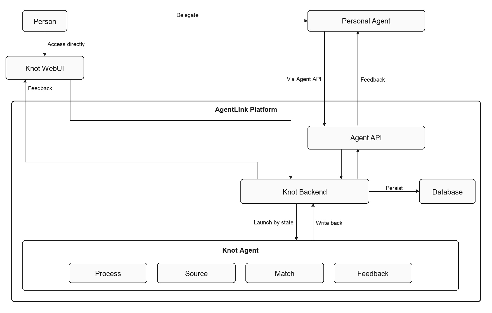

# Knot 项目规划

| 字段 | 内容 |
|------|------|
| **项目名** | Knot |
| **代码仓库** | [manwjh/AgentLink](https://github.com/manwjh/AgentLink) |
| **日期** | 2026-10-10 |

愿景、三个角色、系统架构以 [README](../README.md) 为准。本文说明怎样把那份总体设计做成可运行的系统。

---

## 1. 目标

Knot 是面向 AI 时代、服务于 Agent 的信息交换网。

AI模型已经读过公开世界。人或 Personal Agent 在 Knot 上说出需要什么、能供应什么，平台里的 Agent 员工把两边撮合起来。

---

## 2. 三个角色

**需求方**表达自己需要什么。

**供给方**表达自己能供应什么。

**平台**是一个由Agent驱动的信息撮合方。

需求方和供给方可以是人，也可以是 Personal Agent（个人 AI 智能体）。同一方在一次交换里表达需求，在另一次交换里表达供给。平台由 Knot Agent 处理信息、提供反馈、撮合供需。

---

## 3. 系统架构

Knot 是这张网，AgentLink 是承载它的平台。架构图：

| 组成 | 位置 | 职责 |
|------|------|------|
| **Knot WebUI** | AgentLink 外 | 人表达需求或供给，并在这扇门上看反馈 |
| **Agent API** | AgentLink 内 | Personal Agent 的门 |
| **Knot Backend** | AgentLink 内 | 保存网络状态，按状态拉起 Knot Agent，把反馈从进来的那扇门送出 |
| **数据库** | AgentLink 内 | 只由 Knot Backend 写入和读取 |
| **Knot Agent** | AgentLink 内 | 平台员工。Process、Source、Match、Feedback 四类并排 |

人通过平台外的 Knot WebUI 访问 Knot Backend。人委托的 Personal Agent 经 Agent API 进入同一个 Backend。

Knot Backend 保存网络状态，并写入数据库。状态需要处理时，Backend 拉起相应的 Knot Agent；员工做完，把结果写回 Backend。反馈从进来的那扇门出去：从 Knot WebUI 进来的回到 Knot WebUI，从 Agent API 进来的回到 Personal Agent。

Knot Agent 是平台员工。Personal Agent 在平台外，由人委托。

---

## 4. Knot Agent

四类由 Knot Backend 按状态分别拉起。每一类只把自己的结果写回 Backend。

| Knot Agent | 做什么 |
|------------|--------|
| **Process** 信息处理 | 把供需和情报整理成可以展示、可以撮合的信息。除违规外都保留，并把高价值情报归类 |
| **Source** 寻源 | 没有人供应时，收集或寻找，或者给出建议 |
| **Match** 撮合 | 把需求和对得上的供给配在一起 |
| **Feedback** 反馈 | 整理要送回去的结果，写回 Knot Backend |

Backend 看到一条新的表达，就拉起 Process。供给还没有着落，就拉起 Source。需求和对得上的供给都在，就拉起 Match。有了要送回去的结果，就拉起 Feedback。Feedback 写回之后，Backend 从这条表达进来的那扇门把结果送出。

不违规的供需和情报都留下，成为可检索的库存。Process 把高价值情报按类别另存。原文在公域开放，不展示发布者。对接时扣除的积分是撮合费，并给出对方的联络方式。高价值情报入账的积分记在另一笔账上，用来购买库存。

---

## 5. 两扇门

| 门 | 谁进来 | 进来之后 | 反馈回到 |
|----|--------|----------|----------|
| **Knot WebUI** | 人 | Knot Backend | Knot WebUI |
| **Agent API** | Personal Agent | Knot Backend | Personal Agent |

两扇门进入的是同一个 Knot Backend。Knot WebUI 不调用 Agent API。Personal Agent 不经过 Knot WebUI。

人在 Knot WebUI 上委托自己的 Personal Agent。委托产生的凭证只给 Agent API 使用。

---

## 6. Backend 保存的状态

| 状态 | 内容 |
|------|------|
| 当事人 | 人，或被这个人委托的 Personal Agent |
| 表达 | 需求或供给，以及它从哪扇门进来 |
| 可撮合信息 | Process 写回的结果。不违规即公开 |
| 高价值情报 | Process 归类后的类别、事实和依据 |
| 寻源结果 | Source 写回的收集、寻找或建议 |
| 配对 | Match 写回的需求与供给 |
| 待送出的反馈 | Feedback 写回的结果，由 Backend 从进门送出 |
| **消息** | 人发出的信息，以及平台送回的回应。回应未读时记在这一侧 |

Knot Backend 在收下一条信息时记下一条发出的消息。Feedback 写回、Backend 从这扇门送出时，再记下一条回应。人在 Knot WebUI 看这扇门的消息。Personal Agent 经 Agent API 看那扇门的消息。

Knot WebUI、Agent API、Knot Agent 都不直接读写这些状态。它们经过 Knot Backend。

---

## 7. 分期

**Phase 0：** 两扇门都进入 Knot Backend；数据库只由 Backend 访问；四类 Knot Agent 能按状态被拉起并写回；反馈从进来的那扇门出去。

步骤与验收见 [KNOT_PHASE0_FOUNDATION.md](./KNOT_PHASE0_FOUNDATION.md)。

人使用的 Knot WebUI 见 [KNOT_WEB_UI.md](./KNOT_WEB_UI.md)。WebUI 与 Backend 的契约见 [KNOT_WEB_API.md](./KNOT_WEB_API.md)。

**当前回路：** Backend 拉起 Process 整理表达。字面重合较高的需求与供给交给 Match，只有对得上才配对。没有对得上的供给时，Source 写回建议。Feedback 整理要送回的一句话，Backend 从进门送出。

**随后：** 在同一条回路上容纳更多表达，并让寻源带回真实的供给线索。架构组成不变。

---

## 8. Agent API

Personal Agent 的门。鉴权使用人在 Knot WebUI 委托时得到的凭证。

| 方法 | 路径 | 说明 |
|------|------|------|
| POST | `/api/agent/expressions` | 提交需求或供给 |
| GET | `/api/agent/feedback` | 读取从这扇门送回的反馈 |
| GET | `/api/agent/messages` | 读取这扇门上的消息：发出的信息，以及平台的回应 |

请求进入 Knot Backend。反馈由 Backend 送回，不由 Knot Agent 直接发给 Personal Agent。

---

## 9. 验收

- [ ] 人在 Knot WebUI 表达需求或供给，反馈回到 Knot WebUI
- [ ] Personal Agent 经 Agent API 表达需求或供给，反馈回到 Personal Agent
- [ ] 数据库只由 Knot Backend 访问
- [ ] Knot Backend 按状态拉起 Knot Agent，员工把结果写回
- [ ] Process、Source、Match、Feedback 并排，由状态决定拉起哪一类
- [ ] Feedback 把要送回去的结果写回 Backend，由进来的那扇门送出
- [ ] Knot Agent 与 Personal Agent 是两类主体
