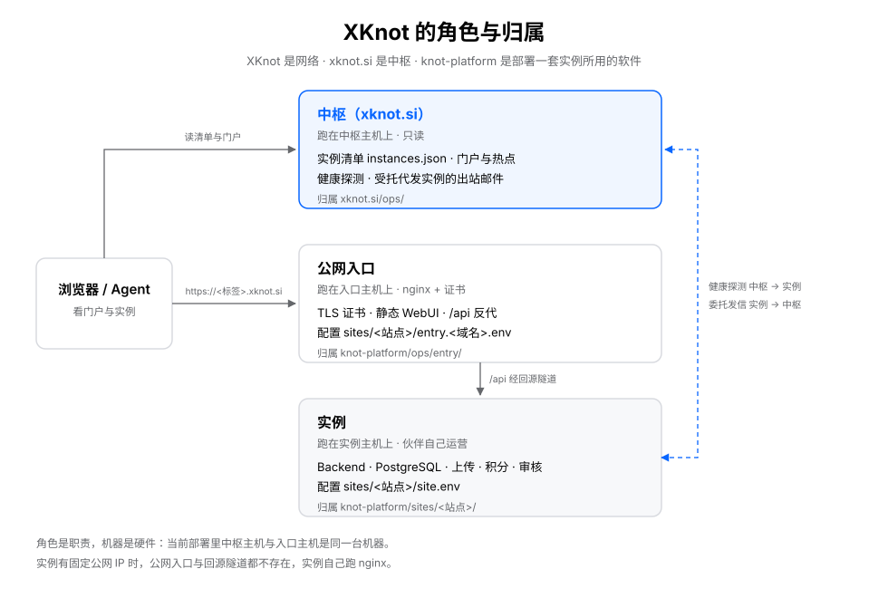

# XKnot concepts and ownership

In one sentence: **XKnot is the network, `xknot.si` is the hub, and `knot-platform` is the software used to deploy an instance.**

## Roles and ownership

| Role | What it is | Ownership |
|------|--------|------|
| **Hub** | The hub service on `xknot.si`: receives join applications and writes them to the DB, issues subdomains and onboarding files, maintains the instance roster and portal, health probes, trending showcase, delegated mail. It does not write members' records and accounts, but applications, claims, and read-only queries are open to the public | `xknot.si/` |
| **Hub host** | The machine running the hub; hostname fixed at `xknot.si` | `xknot.si/ops/` |
| **Instance** | An independently deployed Knot: its own database, accounts, credits, review, uploads | The partner themselves |
| **Instance host** | The machine running the instance Backend, Postgres, and upload directory | `knot-platform/sites/<site>/` |
| **Public entry** | The nginx for the instance domain: certificates, public HTTPS, static WebUI, `/api` reverse proxy | Instance side, `knot-platform/ops/entry/` |
| **Entry host** | The machine running the public entry | Same as above |
| **Origin tunnel** | The SSH reverse tunnel the instance dials out, connecting the entry host's loopback port to the instance | `KNOT_TUNNEL_*` in `sites/<site>/site.env` |

**The entry is stored in two places by scope** — this is not two concepts, but two granularities of the same thing:

| Location | What it holds | Reusable by another instance? |
|------|--------|------------------|
| `knot-platform/ops/entry/` | nginx conf templates, cache snippets, sshd tunnel templates, render and push scripts | Yes → it is software |
| `xknot.si/ops/entry/` | The specific conf and runbook for an already-issued subdomain (e.g. `<subdomain>.xknot.si.conf`) | No → it is the record of this issuance |

## One machine can wear several roles

Roles are responsibilities, machines are hardware. **The same machine can be both the hub host and the entry host** — the current deployment is exactly this: `xknot.si` and `wang.xknot.si` sit on the same host.

But ownership follows the role, not the machine:

- Hub config goes only in `xknot.si/ops/`;
- Entry config: reusable templates go in `knot-platform/ops/entry/`, and the site installed on the entry host is written in `sites/<site>/entry.<domain>.env`; the one the hub installs on a partner's behalf (subdomain hardcoded) goes in `xknot.si/ops/entry/`;
- The instance's own config goes only in `sites/<site>/site.env` and `platform.env`.

The two projects never reference each other's files; they connect only through the HTTP contract and onboarding files. So "the hub also runs on this machine" is not a dependency of instance deployment, and vice versa.

## When the entry layer does not exist

**Federation members always go through the entry host + origin tunnel.** The roster `mode` has only one value `subdomain`, and `tunnel` is mandatory; the listing `url` must be the hub-issued `https://<label>.xknot.si`. For the onboarding flow, see [xknot.si/docs/JOIN.md](../xknot.si/docs/JOIN.md) §2.

If an instance faces outward **using its own domain**, it does not need the join-federation step: no entry host, no origin tunnel; DNS points directly at the instance host, and the instance runs its own nginx and signs its own certificates. Such sites are not registered in `instances.json` and do not take part in federation probes.

**"Subdomain pointing at the partner's own fixed IP, without a tunnel" is not in the contract**: `validate-federation.mjs` rejects it, and there are no landing steps. For a fixed IP, use your own domain and self-host the site.

## Words not to use anymore

| Don't write | Why |
|------|--------|
| edge, cloud edge, edge host | Sounds like a CDN edge node, and is often co-located with the hub; readers can't tell whether it means the hub or the entry |
| node | Implies a peer-to-peer network; use "instance" |
| sub-site, branch site | Implies a subordinate replica; each instance is sovereign, use "instance" |
| center, main station, flagship station, aggregation platform | Contradicts member autonomy; use "hub" |

## Read on

| Want to know | See |
|--------|----|
| Terms, forbidden words, standard sentences | [xknot.si/docs/NAMING.md](../xknot.si/docs/NAMING.md) |
| The hub-instance contract | [xknot.si/docs/FEDERATION.md](../xknot.si/docs/FEDERATION.md) |
| How the hub runs and is verified | [xknot.si/docs/HUB.md](../xknot.si/docs/HUB.md) |
| How an instance deploys and the entry is configured | [knot-platform/README.md](../knot-platform/README.md), [`knot-platform/ops/README.md`](../knot-platform/ops/README.md), [`knot-platform/ops/entry/README.md`](../knot-platform/ops/entry/README.md) |
