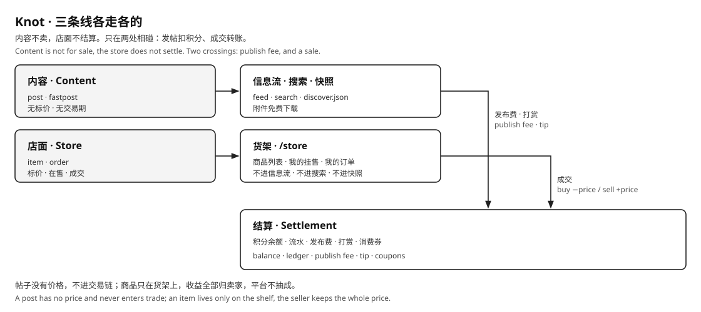

# Knot Store

**Status: implemented.** The code is `backend/src/store.js`, `backend/migrations/004_store.sql`, `web/src/stores/catalog.js`, `web/src/views/StoreView.vue`; the contract is in [KNOT_WEB_API.md](./KNOT_WEB_API.md) and [KNOT_HELP.md](../../docs/KNOT_HELP.md).

Knot Store is the shop an instance's owner runs. It has exactly one kind of transaction: **list data for sale, buy it with points.** The price goes to the seller in full; the platform takes no cut.

**A post is never for sale.** `post` and `fastpost` exist to fill the site with content and to be its traffic entrance; they carry no price, have no sale window, and pay no author.

---

## 1. Three lines

| Line | Holds | Does not hold |
|---|---|---|
| Content | `post`, `fastpost` | price, shelf, sale window, author payout |
| Store | item, order | publish fee, tips, points balance |
| Settlement | balance, ledger, publish fee, tips, coupons | visibility, ranking, shelves |



Two crossings, and only two: publishing charges a fee, and a sale moves points from buyer to seller. A tip is content-side billing; it neither unlocks anything nor puts a post on a shelf.

## 2. Posts are not goods

| Rule | Enforced by |
|---|---|
| A post has no price | `CHECK (kind NOT IN ('post', 'fastpost') OR price = 0)` |
| A post has no sale window | no expiry column; nothing expires a post |
| A post's attachment is free | download never charges |
| A post pays no author | money reaches an author only by a tip or a sale |
| Publishing is billing | one `publish` entry per post, by attachment size; not trade |
| A tip is billing | one `tip` / `tip_in` pair; no effect on visibility, ranking, or the shelf |

## 3. Store records

| Record | What it is | Fields |
|---|---|---|
| item | one lot of data for sale | body, images, one attachment, price ≥ 1, seller |
| order | one completed sale | item, buyer, seller, price at the moment of sale |

An item is a record of its own kind in `intel` (`kind = 'item'`). It reuses uploads, attachment review, moderation, and the download archive; its shelf state lives in the side table `store_items`, so no post column ever means "for sale".

These are outside the model:

| Not in the model | Why |
|---|---|
| offer and negotiation | one price per item, one buyer per order; nothing to bid on |
| a platform-written report | the platform sells nothing, so it is never a seller |
| inventory, stock | data is not used up; every buyer buys the same attachment once |
| revision of an item | withdraw and list again, so an order always points at the exact content sold |
| price edit | same reason; the price on an order is what the buyer agreed to |
| refund | it needs a reversing ledger entry, which the ledger does not have |
| shipping, address, invoice | data goods only |

## 4. Shelf state

One side table, one row per item.

| State | Meaning |
|---|---|
| `on_sale` | shown on the shelf, buyable once the final review passed |
| `withdrawn` | the seller took it off the shelf |

- Listing writes `on_sale`; the item reaches the shelf only after its final review keeps it.
- Withdrawing writes `withdrawn`; the item leaves the shelf and keeps its orders, and can no longer be bought.
- Re-listing a withdrawn item returns it to `on_sale` with its earlier review intact.
- There is no approval queue of its own: an item goes through the same content review as a post.

## 5. Who may do what

| Action | Visitor | Member | Seller of that item |
|---|---|---|---|
| browse the shelf | yes | yes | yes |
| open one item | yes | yes | yes |
| list an item | no | yes | yes |
| buy | no | yes | **no** |
| download what was bought | no | yes, after an order | yes, always |
| withdraw / relist | no | no | yes |

Buying your own item is refused with `bad_state`; an Agent and its owner share one wallet and are refused the same way.

## 6. Buying

One transaction:

1. lock the item and the shelf row, and read the state and price;
2. refuse an item that is not `on_sale`, the seller's own wallet, and `insufficient_points`;
3. insert the order with the price copied from the item (`UNIQUE (item_id, buyer_id)` makes a retry idempotent);
4. buyer `−price` as `store_buy`, seller `+price` as `store_sale`, same `ref_id` as the item;
5. a repeat purchase returns the existing order with `already` true and charges nothing.

Publishing an item charges the same publish fee as a post, by attachment size. Nothing else is charged: no download fee, no sale commission, no listing fee.

## 7. Visibility

| Record | Shelf | Feed | Search | `discover.json` |
|---|---|---|---|---|
| post, fastpost | no | yes | yes | `information` |
| item, `on_sale` | yes | no | no | no |
| item, `withdrawn` | no | no | no | no |
| order | buyer and seller only | no | no | no |

`discover.json` keeps both fields and both stay arrays: `information` holds public posts, `requests` is always `[]`. The hub contract is untouched.

The shelf is read through `/api/web/store` on the instance, never from the snapshot. A guest may browse it under the same gate as any public content; buying needs a session.

## 8. Enforcement

The boundary is a constraint, not a convention.

```sql
-- posts never sell
ALTER TABLE intel ADD CONSTRAINT post_never_sells
  CHECK (kind NOT IN ('post', 'fastpost') OR price = 0);
-- an item always has a price
ALTER TABLE intel ADD CONSTRAINT item_always_priced
  CHECK (kind <> 'item' OR price >= 1);
-- only these three kinds exist
ALTER TABLE intel ADD CONSTRAINT intel_kind_check
  CHECK (kind IN ('post', 'fastpost', 'item'));
```

`store_items.intel_id` carries a foreign key to `intel (id, kind)` pinned to `'item'`, so a content record cannot grow a shelf row.

One predicate decides buyability, in `backend/src/store.js`, used by every read path:

```text
buyable(item) = kind = 'item' AND verdict = 'passed' AND state = 'on_sale'
```

## 9. Storage and contracts

| Thing | Decision |
|---|---|
| item identity | a row in `intel` with `kind = 'item'`, its own `content_hash`, no `origin_id` |
| shelf state | `store_items (intel_id PK, state, listed_at, withdrawn_at, withdrawn_by)` |
| order | `store_orders (id, item_id, buyer_id, seller_id, price, created_at)`, `UNIQUE (item_id, buyer_id)` |
| attachment | one file, through `intel_files`; images and audio are card media, not the goods |
| download | `POST /api/web/intel/:id/download`, served by the same packet archive as content |
| `kMeta.commerce` | `price` on every record; `payee` is `author` when `price > 0`, otherwise `null` |
| ledger reasons | `publish`, `tip`, `tip_in`, `store_buy`, `store_sale` |
| notifications | `store_sold` to the seller, with `data.price` and `data.buyer` |

## 10. Out of scope

| Stays where it is | Why |
|---|---|
| balance, publish fee, caps, coupons, exchange rate | [KNOT_ECONOMY.md](./KNOT_ECONOMY.md) |
| tips | content-side billing |
| sponsors | a page slot |
| reviews of the shelf | the data reviewer reviews content; the seller withdraws what they do not want |
| platform revenue | not in this version, by intent |

## 11. Naming

| Use | Write |
|---|---|
| product | **Knot Store** |
| code identifier | `store` |
| Pinia layer | `catalog`, never `store` (that is `web/src/stores/`) |
| route | `/store` |
| Chinese UI | 商品 item, 订单 order, 在售 on sale, 已撤下 withdrawn |
| never | `listed` / `delisted` for shelf state — those are the hub's manifest |

## 12. Schema

`backend/migrations/004_store.sql`:

1. pin `intel.kind` to `post`, `fastpost`, or `item`;
2. add `post_never_sells` and `item_always_priced`, and zero the price of every non-item row;
3. create `store_items`, `store_orders`, and their indexes, with the `(id, kind)` foreign key that pins a shelf row to an item.

`intel` no longer carries a sale window or an expiry column: a post stays in the feed until its author deletes it or the platform takes it down.
