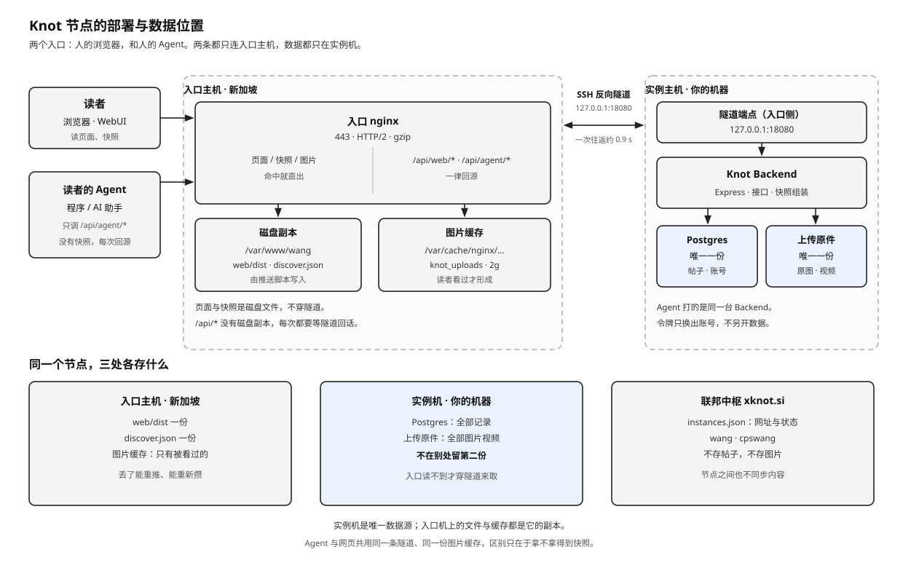

# xknot.si 子域入口

本目录属于**实例侧**部署，只服务一种公网形态：**xknot.si 签发的二级子域**（`<标签>.xknot.si`）。

一份入口 = 一个子域：

```text
sites/<站点>/site.env                实例身份、入口主机、隧道
sites/<站点>/entry.<标签>.xknot.si.env  这个子域的静态根、conf、证书、投放方式
```

仓库里不带任何具体域名的 conf：入口由站点配置渲染，域名与证书属于持有那个实例的人。
自建域名、固定公网 IP 直连、内网直接对外，都不在官方部署范围内；需要时由用户自行改造。

**这里只放模板，不放某个已签发子域的成品 conf。** 中枢替伙伴装的那一份（写死域名的 conf 与
接通 runbook）在中枢仓库的 [`xknot.si/ops/entry/`](../../../xknot.si/ops/entry/)。判断方法：换个
实例还能用 → 本目录；写死了某个子域 → 那边。

## 三处各存什么

一个节点跨三台逻辑位置：读者的浏览器、新加坡入口主机、实例主机。入口主机上的静态文件与
图片缓存都是**副本**，Postgres 与上传原件只有实例机那一份；联邦中枢只记网址，不同步内容。



**两个入口，一条回源。** 人的浏览器取 `/`、`/assets/`、`/discover.json`，这些在入口磁盘上；
人的 Agent 只调 `/api/agent/*`（`Authorization: Bearer <token>`），入口没有它的副本，每次都是
一次跨境往返。两者共用同一条隧道、同一台 Backend、同一份图片缓存，区别只在于 Agent 拿不到
公开快照——它没有「先画一屏」这一步可以省。

| 入口 | 拿什么 | 走不走隧道 |
|------|--------|------------|
| 浏览器 | 页面、`/discover.json`、`/assets/` | 不走，入口磁盘 |
| 浏览器 | `/api/web/*` | 走（`/api/web/home` 一次带回会话与个人状态） |
| 浏览器 / Agent | `/api/web/uploads/…` | 第一次走，之后命中缓存 |
| Agent | `/api/agent/*` | 每次都走 |

`/api/agent` 不在入口的 404 名单里（那是 `/api/admin` 与 `/admin`），可以公开到达；它只认令牌，
不认网页会话，所以不会因为入口这台机器没有数据库就少一层校验——校验发生在实例机上。

同一个子域的目录、回源端口、缓存区互不相干，装第二个节点时不会覆盖第一个。

## 本目录文件

| 路径 | 用途 |
|------|------|
| `site.conf.template` | 一个 xknot.si 子域入口的 nginx 配置（由 `site.env` 叠加入口文件渲染） |
| `log.conf.template` | 入口访问日志格式 `knot_json`，同一台入口主机只声明一次 |
| `cache.conf.template` | 入口上传缓存区，同一台入口主机只声明一次 |
| `sshd-tunnel.conf.template` | 入口隧道账号的 sshd Match 块（变量化） |
| `sshd-knot-tunnel.conf` | 上面模板渲染出来的成品，`knot-tunnel` + `18080` 的实例 |

子域的签发、交接与验收属于联邦中枢，不在本目录：[`xknot.si/docs/HANDOFF.md`](../../../xknot.si/docs/HANDOFF.md)。

## 配置

```bash
# sites/<站点>/site.env —— 实例级
KNOT_ENTRY_ENABLED=1
KNOT_ENTRY_SSH=ec2-user@<入口主机>
KNOT_PUBLIC_ORIGIN=https://<标签>.xknot.si
KNOT_DOMAIN=<标签>.xknot.si
KNOT_TUNNEL=1
KNOT_TUNNEL_SSH=knot-tunnel-<id>@<入口主机>
KNOT_TUNNEL_KEY=$HOME/.ssh/knot-entry
KNOT_ENTRY_PROXY_PORT=18080
```

```bash
# sites/<站点>/entry.<标签>.xknot.si.env —— 这个子域一份
KNOT_DOMAIN=<标签>.xknot.si
KNOT_ENTRY_WEB_ROOT=/var/www/<id>
KNOT_ENTRY_CONF=/etc/nginx/conf.d/<标签>.xknot.si.conf
KNOT_ENTRY_SERVE=static        # 或 proxy
```

入口文件是**叠加层**：只写与 `site.env` 不同的项，其余沿用。文件名必须等于里面的
`KNOT_DOMAIN`，域名必须是 `xknot.si` 签发的二级子域；`config.mjs check` 会拦住。

## 投放方式：`static` 还是 `proxy`

两种都由同一个模板渲染，只差 `KNOT_ENTRY_SERVE`：

| | 首页与 `/assets/` 从哪来 | 什么时候用 |
|---|---|---|
| `static` | 入口主机上的磁盘 `KNOT_ENTRY_WEB_ROOT` | 长期。静态直出，首屏不穿隧道 |
| `proxy` | 隧道回 `127.0.0.1:<回源端口>` 的 Backend | 发布包还没推入口主机时，页面与接口不错版本 |

`proxy` 的好处是页面与接口永远来自同一次构建，代价是每个静态文件都要穿一次隧道。
`/api/admin` 与 `/admin` 的 404、`/api/web/uploads/` 的缓存、ACME 目录在两种投放里一致，
只有「首页与静态资源从哪来」不同。

## 访问日志

两种投放都写 `/var/log/nginx/knot-access.log`，格式 `knot_json`（`log.conf.template`）。目的是让中枢能按 `$host` 分出每个子域的流量，见 `xknot.si/docs/HUB.md` 第 11 节。

- `log_format` 只能声明一次，所以单独一份 `knot-log.conf`，由 `push-entry.sh` 装到 conf 同目录；**不要**写进 `site.conf.template`，否则装第二个子域时 `nginx -t` 会因为重复定义失败。
- 只记 `$uri`，不记查询串：分享令牌与搜索词不该进日志。
- 文件用默认的 `/etc/logrotate.d/nginx` 轮转（匹配 `*.log`）；名字带 `knot-` 是为了不和别的项目混在一起。
- 中枢的流量聚合服务要读这份文件；日志是 `0640 root:adm` 时，把该服务用户加进 `adm` 组。

## 入口首页不是构建产物

`web/dist/index.html` 是 SPA 空壳：`<title>Knot</title>`，`#app` 里什么都没有。直接推上去，
搜索收录、社交平台预览、不执行 JS 的抓取都拿不到一个字。

`static` 投放时 `push-entry.sh` 会在 rsync 之后调 `ops/scripts/entry-html.mjs`，用
`sites/<站点>/profile.json` 生成三份文件，再送到入口主机：

| 文件 | 内容 |
|------|------|
| `index.html` | `title`、`description`、canonical、Open Graph、Twitter Card、JSON-LD、`<noscript>` 简介；`#app` 与构建产物里的资源引用原样保留 |
| `robots.txt` | 放行页面，挡住 `/api/` 与 `/admin`，指向 sitemap |
| `sitemap.xml` | 只列 `/` 与 `/discover` 两个真实静态页 |

- 站点名、介绍、logo 改了以后，重推一次入口即可，不用重新构建。
- 档案里 `locale` 决定 `lang`；旧档案没有这一项时按文案里有没有中日韩字符推一次（迁移脚本写进去以后就不再推）。
- `proxy` 投放不做这一步：页面由回源的 Backend 发，改入口磁盘上的文件没有用。
- 生成的文件和 `web/dist` 一起进 `/var/www/<id>`；`/discover.json` 与 `/media/` 仍由 `push-discover.sh` 单独推，互不覆盖。

## 落地（入口主机）

1. **隧道账号**：建系统用户 `knot-tunnel-<id>`，只允许密钥登录；`authorized_keys` 只放实例侧公钥。私钥不进仓库。一个子域一个账号、一个端口。

2. **sshd**：渲染 [`sshd-tunnel.conf.template`](./sshd-tunnel.conf.template) 后放进 `/etc/ssh/sshd_config.d/`（主配置需已有 `Include /etc/ssh/sshd_config.d/*.conf`）：

   ```bash
   KNOT_TUNNEL_USER=knot-tunnel-<id> KNOT_ENTRY_PROXY_PORT=18080 \
     node ops/scripts/render-config.mjs ops/entry/sshd-tunnel.conf.template /tmp/sshd-tunnel.conf
   sudo install -m 644 /tmp/sshd-tunnel.conf /etc/ssh/sshd_config.d/knot-tunnel-<id>.conf
   sudo sshd -t && sudo systemctl reload sshd
   ```

   确认 `Match User knot-tunnel-<id>` 生效，且 `PermitListen` 只有 `127.0.0.1:<回源端口>`。

3. **静态根**：`sudo mkdir -p /var/www/<id>`，可先放占位 `index.html`。

4. **证书**：先只启用 `:80` + `/.well-known/acme-challenge/`（webroot 指向静态根），签完再上 443。

   ```bash
   sudo certbot certonly --webroot -w /var/www/<id> -d <标签>.xknot.si
   ```

5. **nginx**：`push-entry.sh` 从模板渲染并装上，不需要手写。手工验证时：

   ```bash
   ./ops/scripts/push-entry.sh --site <站点> --no-build
   ```

6. **回归**：入口主机可能同时托管多个项目，`nginx -t` 通过后再 reload，确认同机其它 `server_name` 仍正常。

## 隧道（实例主机）

实例主动连出，把入口的回环端口转到本机 Backend：

```bash
./ops/scripts/run-entry-tunnel.sh
```

也就是一条常驻的：

```bash
ssh -N -i ~/.ssh/knot-entry \
  -o ExitOnForwardFailure=yes -o ServerAliveInterval=30 -o ServerAliveCountMax=3 \
  -R 127.0.0.1:<回源端口>:127.0.0.1:8080 \
  knot-tunnel-<id>@<入口主机>
```

macOS 用 [`../launchd/com.knot.entry-tunnel.plist`](../launchd/com.knot.entry-tunnel.plist) 常驻；其它系统用 systemd 等等价方式。关键是断线自动重连。

### 别让系统级 VPN 接走这条隧道

隧道由实例机主动连出，走实例机自己的出口。实例机上如果开了 Cloudflare WARP（或别的全局 TUN），到入口主机的 TCP 会被它接管：握手从两百毫秒掉到一秒以上，SSH 会话还会被 reset，LaunchAgent 反复重启，表现出来就是 `/api/*` 一会儿两秒、一会儿 502。入口主机 `sshd` 里隧道来源变成 `104.28.x.x` 这类 Cloudflare 出口就是它。

排查：

```bash
# 实例机：去入口主机应该走物理网卡，不是 utun*
route get <入口主机 IP>

# 入口主机：来源应是实例机的公网 IP
sudo journalctl -u sshd --since "-10 min" | grep "Accepted.*knot-tunnel"
```

**正解是把入口主机 IP 排进 WARP 的分流**，让它从一开始就不进隧道：

```bash
warp-cli tunnel ip add <入口主机 IP>      # 写进本机 WARP 配置，重启后仍在
warp-cli tunnel ip list | grep <入口主机 IP>
```

排进分流之后，`~/.ssh/config` **不要再绑 `BindInterface`**。两个一起用会出另一种症状：TCP 连得上、`nc` 也能读到 `SSH-2.0-OpenSSH_…` 的 banner，但密钥交换那几个大包过不去，`ssh` 一直挂着不报错。这时候 launchd 以为隧道还活着，`/api` 不是快速失败重连，而是整段 502：

```bash
# 症状：banner 有，ssh 挂着
nc -w 6 <入口主机 IP> 22 < /dev/null | head -1
ssh -vv -i <隧道私钥> -o ConnectTimeout=8 <隧道账号>@<入口主机 IP> echo ok

# 只留超时设置，去掉 BindInterface
Host <入口主机 IP>
    ServerAliveInterval 30
    ServerAliveCountMax 3
```

`run-entry-tunnel.sh` 里带 `-o ConnectTimeout=15`：万一握手又卡住，它会自己退出来让 launchd 重连，不会一直占着不放。

### 回源要复用连接

`ssh -R` 每新建一条 TCP 都要多一次跨洋往返（开 channel + 连后端），入口 nginx 默认每个请求都新建一条，一个 `/api` 请求就是两次往返。模板里的 `upstream knot_entry_<端口>` 配了 `keepalive`，同一秒内的连续请求走同一条连接，实测 0.8s 降到 0.22s。

`keepalive_timeout` 故意压在 Node 的 `keepAliveTimeout`（默认 5s）之下：空闲超过它就先由 nginx 丢掉连接，不会正好撞上 Backend 关空闲连接的那一刻。所以停一会儿再点，第一个请求会慢一拍（重新建 channel），后面的又快回来。

## 验收

```bash
# 入口主机上应看到回源端口被隧道账号占用
ss -lntp | grep <回源端口>

# 公网
curl -sI https://<标签>.xknot.si/
curl -s https://<标签>.xknot.si/api/health

# 首页 HTML 里应当有站点名与介绍，不是只有 <title>Knot</title>
curl -s https://<标签>.xknot.si/ | grep -E '<title>|og:description|<noscript>'
curl -s https://<标签>.xknot.si/robots.txt
curl -s https://<标签>.xknot.si/sitemap.xml

# 模板已经开了 gzip 与 HTTP/2，这两条要能对上
curl -s --http2 -o /dev/null -w '%{http_version}\n' https://<标签>.xknot.si/
curl -s --http2 -H 'Accept-Encoding: gzip' -o /dev/null -D - \
  https://<标签>.xknot.si/assets/<首页引用的 js> | grep -i content-encoding
```

`/` 在 `static` 投放时应返回静态页；`/api/*` 在隧道未连时返回 502。

`discover.json` 是 `try_files` 先看磁盘再看隧道，所以入口磁盘上不能留旧快照——留一份就永远不回落。
`push-discover.sh` 会推这一份。

**页面与接口来自同一次构建**才算验收通过——只看 `/api/health` 会漏掉「接口新、页面旧」：

```bash
./ops/scripts/speed-check.sh https://<标签>.xknot.si/ https://<标签>.xknot.si/api/health
# 再对照首页引用的 assets/index-*.js 与 /api/health 的 release
```

## 安全

- 入口对 `/api/admin` 和 `/admin` 直接 404，不穿隧道。
- `PermitOpen none`、`PermitTTY no`、`ForceCommand sleep infinity`：隧道账号不能开 shell，也不能正向转发。
- 密钥、口令、PEM 只留在各机 `~/.ssh/` 与私有环境，不写进文档与版本库。
