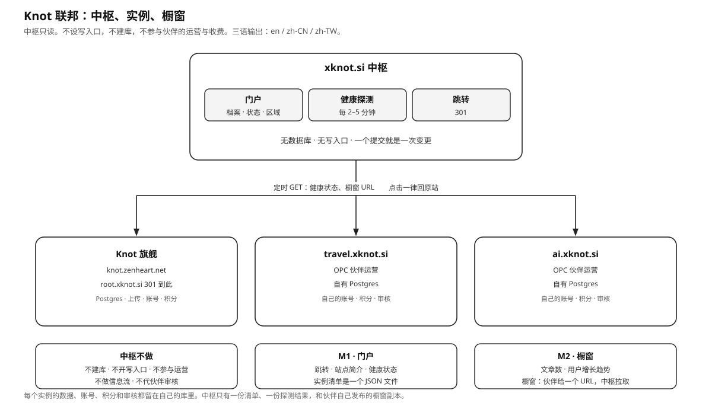

# Knot 联邦 · 中枢契约

版本 1.0，2026-10-19。中枢是轻量入口。

术语与中英文写法见 [NAMING.md](NAMING.md)，语种与区域规则见 [I18N.md](I18N.md)。本文出现的概念名以那两份为准。



## 0. 摘要

`xknot.si` 是 Knot 联邦的中枢，提供三项信息：**站点档案、运行状态、热点橱窗**。用户、内容、积分和运营属于各实例。

## 1. 三层信息

中枢与实例之间只交换三层信息，按谁写、谁读、信任等级划分：

| 层 | 名字 | 谁写 | 流向 | 变化频率 | 信任 |
|----|------|------|------|----------|------|
| **L1** | 站点档案 | 人（仓库提交） | 中枢读文件 | 很少 | 中枢的权威身份 |
| **L2** | 运行状态 | 实例（机器生成） | 中枢 GET | 分钟级 | 可验证的事实 |
| **L3** | 热点橱窗 | 伙伴（发布在自己站点） | 中枢 GET | 天级 | 伙伴的表达，中枢免审 |

一条规则贯穿三层：

> **中枢只读：一切由中枢主动 GET，清单是唯一的人工入口。**

伙伴登记一个 URL，内容留在自己站点，中枢按时去取。这带来三个性质：

- 中枢没有接收接口，不需要令牌、接收校验、限流和原子写。
- 伙伴不需要向中枢提交材料，也不需要通知任何人。
- 网关只有一个：`instances.json`。改条目、提交、发布，就是全部操作。

三层的信任等级不同：

- L2 是伙伴无法否认的事实。站点不可达就是 `down`；自报的活跃度只做展示。
- L3 是伙伴主动挑选的表达。展示什么由伙伴决定，中枢负责取回、渲染并跳回原站。

## 2. 职责边界

### 2.1 中枢负责

- 维护 `instances.json` 与清单校验。
- 构建时探测 `/api/health`，写 `var/health.json`。
- 构建时拉取 `cardsUrl`，写 `var/cards/{id}.json`。
- 构建三语门户：Vue 3 + Vite，产物是静态文件，运行时只读 `/data/hub.json`。
- `root.xknot.si` 的 301。
- 整组下架违规实例的橱窗。

### 2.2 实例负责

- 用户、会话、账号、积分、订单和结算。
- 内容发布、编辑、撤下、审核与投诉处理。
- 图片和媒体托管。
- 自己的数据库、备份、域名和证书。
- 对欧盟用户的数据主体请求。

### 2.3 新增能力的判定

新增一项能力，数据来源必须满足下面之一：

1. 写在 `instances.json` 里，由人提交。
2. 由中枢按清单里的 URL 主动 GET。

中枢不接收写入。清单之外的数据都由实例发布，中枢只取回副本。

## 3. 实施里程碑

| 里程碑 | 范围 | 交付 |
|--------|------|------|
| **M1** | L1 档案、L2 健康探测、三语门户、区域筛选、`root` 跳转 | 静态站 + 构建脚本 |
| **M2** | L3 热点橱窗、L2 活动数据 | 增加拉取步骤与门户橱窗位 |

两个里程碑都在构建时取数，只产出静态文件，没有常驻服务。

## 4. L1：站点档案

### 4.1 位置与维护

单一真源：`xknot.si/instances.json`。修改、提交、发布即完成一次变更。没有后台和审批界面。

### 4.2 字段

人可读字段按语言分键（`{"en": "...", "zh-CN": "..."}`），标识、URL、状态不分键。语种、回退链和校验规则见 [I18N.md](I18N.md)。

| 组 | 字段 | 约束 |
|----|------|------|
| 标识 | `id` | 小写字母、数字、连字符，2–32 位，清单内唯一，不可改 |
| | `name` | 按语言分键，`en` 必填，每种 ≤40 字 |
| | `shortName` | 按语言分键，可空，每种 ≤12 字 |
| | `logo` | 相对 `xknot.si/web/public/` 的路径，如 `logos/travel.svg`。SVG 或 PNG，≤64KB，正方形。可空，空时显示名称首字母 |
| | `themeColor` | `#RRGGBB`，用于点缀 |
| 地址 | `url` | 中枢上的访问地址，https，各语种共用 |
| | `redirect` | 可空。有值时只做 301 |
| | `canonical` | 真实站点地址，可空 |
| 定位 | `vertical` | `creation`、`travel`、`ai` 或约定值 |
| | `tags` | 按语言分键，每种 ≤5 个短词 |
| | `languages` | 实例界面支持的语言，必含 `en` |
| | `regions` | ISO 3166-1 alpha-2 大写数组，或 `GLOBAL` |
| | `timezone` | IANA 名称，必填 |
| 运营 | `operator` | 按语言分键，每种 ≤80 字 |
| | `owner` | 按语言分键，可空，每种 ≤40 字 |
| | `contact` | 邮箱或 URL，必填 |
| | `social` | `[{ label, url }]`，≤5。`label` 是品牌名，不翻译 |
| | `termsUrl` / `privacyUrl` / `moderationUrl` | 可空 |
| 介绍 | `intro.oneLine` | 按语言分键，`en` 必填，每种 ≤60 字 |
| | `intro.long` | 按语言分键，可空，每种 ≤800 字，MD 子集 |
| 收录 | `since` | ISO 日期 |
| | `tier` | `demo`、`partner`、`community` |
| 状态 | `status` | `active`、`suspended`、`retired` |
| 接口 | `healthUrl` | 可空。有值时探测 L2 |
| | `statsUrl` | 可空。有值时拉取 L2 活动数据 |
| | `cardsUrl` | 可空。有值时拉取 L3 橱窗 |

### 4.3 规则

- `logo` 是唯一进入中枢的二进制。其余图片只存 URL。
- `healthUrl`、`statsUrl`、`cardsUrl` 决定中枢拉取哪些数据；字段为空即跳过，不报错。
- `tier` 只影响展示徽章，不影响排序，不参与评级或分成。
- 只做跳转、没有自站的条目（如 `root`）标 `tier: demo`，不计入实例统计。
- 页面按 `tier`、再按 `since` 排序，顺序稳定。
- 区域只用于分组浏览，不参与排序，不影响收录。
- 最小档案包含 `id`、`name`、`url`、`intro.oneLine`、`languages`、`regions`、`timezone`、`contact`、`since`、`tier`、`status`。不提供任何接口地址也是合法条目。
- 清单必须通过 `ops/validate-instances.mjs` 才发布。

## 5. L2：运行状态

### 5.1 端点

| 端点 | 频率 | 缓存 | 内容 |
|------|------|------|------|
| `/api/health` | 按需（构建时） | `no-store` | `ok`、`version`、`service` |

Knot 实例提供 `GET /api/health`，返回 `{ ok: true, service, version }`。中枢直接使用该端点，实例侧无需改动。

### 5.2 探测判定

- 方法 `GET`，超时 5 秒，不跟随重定向。
- 只接受 `https`。非 https 判 `unknown`。
- 成功：HTTP 200，响应体是 JSON，且 `ok === true`。
- 不读实例的库，不带 Cookie，不带凭据。

### 5.3 状态

| 状态 | 判定 | 展示 |
|------|------|------|
| `up` | 成功且 ≤2 秒 | 绿点 |
| `degraded` | 成功但 >2 秒 | 黄点 |
| `down` | 失败 | 红点 |
| `unknown` | 未探测或 `healthUrl` 为空 | 灰点 |

探测失败保留 `lastOkAt`，只把 `status` 改成 `down`，页面显示「上次正常：3 小时前」。

### 5.4 结果文件

写到 `xknot.si/var/health.json`，门户只读这一份：

```json
{
  "checkedAt": "2026-10-19T02:30:00.000Z",
  "instances": {
    "root": {
      "status": "up",
      "httpStatus": 200,
      "latencyMs": 137,
      "version": "0.2.0",
      "lastOkAt": "2026-10-19T02:30:00.000Z",
      "since": "2026-10-19T02:30:00.000Z",
      "checks": 1,
      "ok": 1,
      "error": null
    }
  }
}
```

- `checks` 和 `ok` 从 `since` 起累计，用于计算可用率。不存逐次历史。
- 文件是唯一状态，删除后条目回到 `unknown`。
- 写入方式：临时文件 + rename。

### 5.5 活动数据

伙伴可选暴露 `statsUrl`，只提供计数：

```json
{
  "generatedAt": "2026-10-19T02:00:00.000Z",
  "posts": { "total": 1234, "last24h": 12, "last7d": 80 },
  "accounts": { "total": 300, "last7d": 18 },
  "authors": { "active7d": 45 }
}
```

- 只有计数，没有昵称、邮箱、头像、正文和记录 id。
- 缺 `statsUrl` 显示「未公开」，不显示 0。
- 自报数字只做展示，不参与排序、评级或分成。
- 只收窗口值，不收日序列。

## 6. L3：热点橱窗

伙伴登记一个 URL（`cardsUrl`），内容发布在自己的站点，中枢在构建时取回。

### 6.1 定位

| 橱窗 | 信息流 |
|------|--------|
| 固定 6 张，全量替换 | 无限下拉 |
| 伙伴自己挑 | 平台按算法排 |
| 只能跳回原站 | 可在中枢读完 |
| 过期就隐藏 | 永久沉淀 |
| 中枢免审，整组可下架 | 中枢承担内容责任 |

### 6.2 拉取

```
GET https://travel.xknot.si/.well-known/knot-cards.json
Accept: application/json
```

响应体是固定封装。中枢取到即覆盖上一份，取不到保留上一份。

```json
{
  "formatVersion": 1,
  "generatedAt": "2026-10-19T02:00:00.000Z",
  "cards": [
    {
      "id": "c-2026-10-19-kyoto",
      "lang": "zh-CN",
      "title": "京都的秋天该怎么走",
      "summary": "一条不赶时间的路线。",
      "body": "## 第一天\n先到南禅寺……",
      "url": "https://travel.xknot.si/?id=0f3c",
      "images": [
        {
          "url": "https://travel.xknot.si/api/web/uploads/abc",
          "alt": "红叶",
          "width": 1200,
          "height": 800
        }
      ],
      "publishedAt": "2026-10-18T09:00:00.000Z",
      "tags": ["日本", "秋季"]
    }
  ]
}
```

### 6.3 约束

| 项 | 约束 |
|----|------|
| `cards` | 1–6 条。每次拉取全量覆盖，不追加 |
| `formatVersion` | 整数，与实例版本解耦 |
| `id` | 实例内唯一，≤64 字符 |
| `lang` | 必填，BCP 47，卡片自身语言 |
| `title` | 必填，≤80 字 |
| `url` | 必填，https，指向该实例自己的主机 |
| `summary` | 可空，≤160 字 |
| `body` | 可空，≤4000 字符，MD 子集：标题、列表、链接、引用、粗体、代码。禁 HTML、脚本、`javascript:` 与 `data:` |
| `images` | 可空，≤3 张。https 绝对地址，主机与 `canonical` 相同；`canonical` 为空时与 `url` 相同 |
| `images[].width` / `height` | 必填，正整数 |
| `publishedAt` | 可空，ISO 时间 |
| `tags` | 可空，≤5 个短词 |
| 响应体 | ≤256KB |
| 拉取时机 | 构建时一次。支持 `ETag` / `If-None-Match` |
| 清空 | 发布 `{"formatVersion":1,"cards":[]}`，下一次构建即清空 |

最小可用的一条只有 `title` 和 `url`。伙伴不维护封装时，可以只给一个指向自己热点列表页的地址，中枢按一条外链渲染。

`cardsUrl` 与 `statsUrl` 是公开只读地址。中枢不带凭据，需要私密数据时不接入。

### 6.4 图片热链

中枢不存图片，只存 URL：

- 节省存储、带宽，避免镜像版权风险。
- 伙伴不可达时显示占位块，不撑破布局。
- 中枢保留整组下架开关。

整组下架是 L3 的治理手段：中枢不逐条审核，出现问题时整组移除。

### 6.5 缓存与失效

- 取到即原子覆盖 `var/cards/{id}.json`，取不到保留上一份。
- 页面显示「更新于 X」。
- 超过 7 天标灰，超过 30 天整组隐藏。读取时判断，不设定时清理。
- 中枢不存历史版本和图片。
- 伙伴改写后，下一次构建同步；整组下架时直接删除文件。

### 6.6 安全

拉取地址来自仓库清单，仍按不可信地址处理：

- 只允许 `https`，禁止 URL 中的用户名和密码。
- 不跟随重定向，超时 5 秒，响应体上限 256KB。
- 解析 DNS 后拒绝回环、私有网段、链路本地和云元数据地址。清单经过人工审核，运行时仍执行同一套检查。
- 不带 Cookie 和凭据。
- 落盘前做白名单清洗：剥掉 HTML 标签，丢弃危险协议，`body` 只渲染 MD 子集。
- 拉取在构建步骤内运行，失败时保留上一次的 `var/cards/`。

## 7. 安全与隐私

- 中枢只访问清单中的地址。加入申请里的站点地址不会在接收时被抓取，只有审核通过、写进清单之后，构建时才探测。
- 探测与拉取在解析 DNS 后拒绝回环、私有网段、链路本地和云元数据地址。
- 唯一的写入路径是 `/api/applications`：只收表单字段，不存文件，不回显 HTML，字段有长度上限与蜜罐。
- 审核台需要管理员账号和会话；账号由命令行建立，口令用 scrypt 加盐存储，会话 Cookie 为 `HttpOnly`、`SameSite=Strict`。
- 门户不执行伙伴脚本，不嵌 iframe。外链带 `rel="noopener noreferrer"`。
- 中枢不保存用户表、作者目录和个体访问画像；申请记录只存站点信息、联系邮箱和哈希后的来源地址。
- `.si` 在欧盟境内。M2 上线前完成一次 GDPR 评估，重点检查自报计数能否反推个体。

## 8. 归属与许可

- 代码以 Apache-2.0 发布，版权人 PaulWang，署名见 `NOTICE`。
- `xknot.si` 及其下签发的子域归 PaulWang 所有，不随代码授权。
- 许可证不授予商标使用权。`Knot`、`xknot`、`xknot.si` 的名称和标识归 PaulWang 所有。
- 收录不改变归属。伙伴的站点、内容和用户属于伙伴。

## 9. 收录与下架

加入是申请制：站点在门户右侧提交表单，运营者人工审核，通过后才写进清单。审核不是自动入驻，也不改变实例自治。

| 阶段 | 发生什么 |
|------|----------|
| 提交 | `POST /api/applications`，字段为名称、地址、简介、运营者、邮箱、区域、时区、标签 |
| 排队 | 同一地址只保留一条未结案申请；来源地址哈希后限流 |
| 审核 | 运营者在 `/admin/` 看记录，核对站点在线、自建、可访问，标记通过、拒绝或搁置 |
| 写清单 | 通过后由 `server/admin-cli.mjs publish <id>` 生成条目并写入 `instances.json`，或手工粘贴 |
| 上线 | 重新构建门户，条目出现在地图与目录里 |

| 情形 | 动作 |
|------|------|
| 新伙伴 | 审核通过 → 写清单 → 重新构建 |
| 改名、换域名 | 修改对应条目 |
| 长期失联 | 探测显示 `down`，条目不自动删除；连续 30 天由人决定 |
| 违法、欺诈、冒充、商标侵权 | 从清单删除，L3 整组下架并删除缓存 |
| 伙伴退出 | 删除条目，删除 L3 缓存，回收子域 |

申请被拒绝或搁置不影响站点本身；申请人可以修正信息后重新提交。中枢不托管内容，下架只影响入口，不影响伙伴站点的数据。
