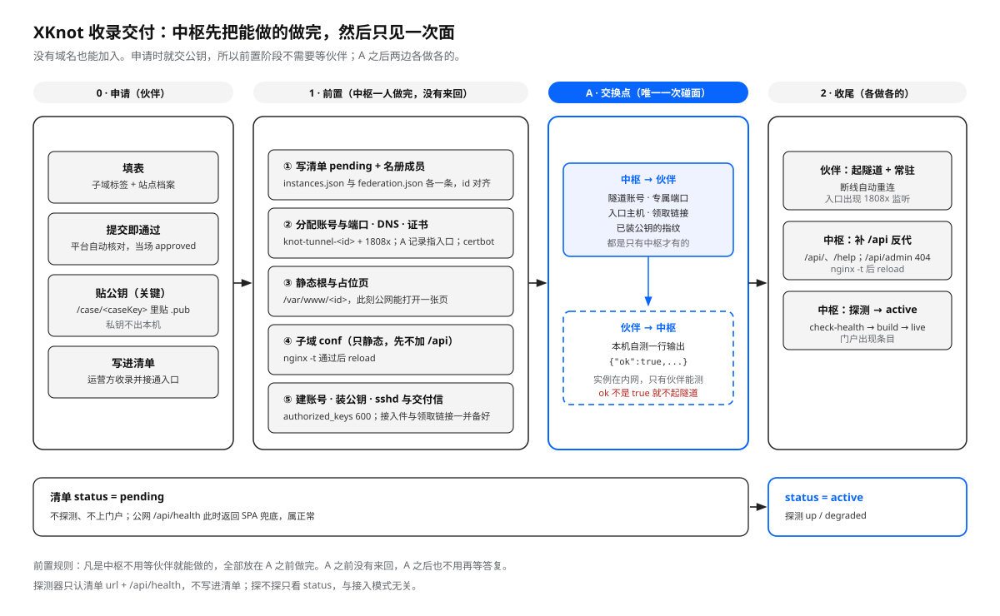

# XKnot 联邦 · 收录交付单

版本 3.2，2026-10-21。

[JOIN.md](JOIN.md) 讲策略：怎么申请、签发后怎么接通。本文只回答一个问题——**从申请通过到实例接通，两边各自做什么、在哪一步碰上**。

> **现状：默认自动。** 申请通过且公钥到齐后，入口主机上的常驻进程 `xknot-provision` 按第 3 节的顺序自动做完前置（`ops/provision-worker.mjs`，步骤代码在 `server/provision.mjs`）。做完后实例按案例键读 `GET /api/case/<key>/progress` 取走入口主机、账号与端口，自己写 `site.env` 并起隧道；中枢探测 `/api/health` 通过就改成 `active`。
>
> 下面第 2–5 节仍然有效，但只在两种情况下用：worker 停着，或某一张单要人工从头做一遍。写进代码的规则以 `server/provision.mjs` 与 `ops/provision-worker.mjs` 为准；两边不一致时先改代码，再改这份单。

每个新实例复制一份填完再开工。填不满的部分就是还没谈定的部分，不要开工。



---

## 0. 一句话

**只碰一次面。** 申请人提交时就把公钥交上来；申请通过后，中枢把**不需要伙伴在场**的配置一次做完（清单、名册、DNS、证书、静态页、入口 conf、账号、公钥、接入件）；然后是一个**交换点 A**，两边各交一样只有自己才有的东西；剩下两步两边各做各的，最后一次探测收尾。

收录不等于接通：写进清单时 `status` 是 `pending`，中枢不探测、门户不展示；`/api/health` 返回 `ok: true` 后才改成 `active`。

申请阶段只确定子域标签。接入只有一种形态：

| 地址 | 签发子域 | 入口隧道 | 交换点 A |
|------|----------|----------|----------|
| `https://<标签>.xknot.si`，中枢签发 | 需要 | 需要 | 账号 + 端口 + 公钥回执 |

自有域名的站点不走这一步：它自己就是入口，不需要签发，也没有隧道。

---

## 1. 四个阶段

| 阶段 | 谁执行 | 结束标志 | 清单 `status` | 运行状态 |
|------|--------|----------|----------------|----------|
| 0 申请 | 伙伴 | 提交（即通过）+ 在案例页贴公钥 | 还没条目 | — |
| 1 前置 | 中枢 | 第 3 节八步全就绪，run 进入 `awaiting_tunnel` | `pending` | `unknown`（合法） |
| A 交换 | 双方一次 | 中枢拿到自测回执；伙伴从 `progress` 拿到入口主机、账号、端口与 `issued`（手工路径另发 `/claim` 链接与交付信） | `pending` | `unknown` |
| 2 收尾 | 双方各做 | 隧道通、`/api` 通、探测 `up` | `active` | `up` 或 `degraded` |

规则只有一条：**凡是中枢不用等伙伴就能做的，全部放在 A 之前做完。** A 之前没有来回，A 之后也不用再等答复。

---

## 2. 阶段 0：申请时就把公钥交上来

| 步骤 | 谁做 | 产物 |
|------|------|------|
| 填表 | 伙伴 | 子域标签 + 站点档案 |
| 提交 | 伙伴 | `POST /api/applications`，平台当场通过并签发子域 |
| 贴公钥 | 伙伴 | `/case/<caseKey>` 里的 textarea，`ssh-ed25519 AAAA…` 一行 |
| 记录 | 中枢 | 控制台只读：申请已是 `approved`，没有审核动作 |

**公钥为什么要在申请阶段交。** 它是前置阶段唯一的输入：账号、`authorized_keys`、sshd `Match` 全靠它。等通过再要一次，就等于多一次来回，A 也会被拖成两轮。案例页在提交后就能提交公钥，已经实现了（`POST /api/case/<key>/public-key`）。

私钥不出本机。伙伴只贴 `.pub` 文本，工作人员不索要、不接收、不复制私钥。

公钥漏交时：前置停在 `account` 这一步——它要拿公钥写 `authorized_keys`，缺了报 `public_key_missing`；后面的 `sshd`、`static`、`dns`、`vhost`、`tls` 等公钥到了再补。run 不进 `awaiting_tunnel`，`progress` 里的 `handoff` 因此一直是 `null`——伙伴这时起隧道也没有参数可用。

---

## 3. 阶段 1：中枢前置（不需要伙伴在场）

按序做完，每步有产物可核。自动路径是 `server/provision.mjs` 的 `STEP_ORDER`：`allocate → publish → account → sshd → static → dns → vhost → tls`，跑完 run 停在 `awaiting_tunnel`，不再寄交付信——实例自己按案例键读 `GET /api/case/<key>/progress` 取回 `handoff { host, account, port }` 与 `issued`，然后写 `tunnel.env` 起隧道。下表按同一顺序列出产物，`validate` 通过才算做完。

| # | 动作 | 产物 | 停下会怎样 |
|---|------|------|------------|
| 1 | 写清单 | `instances.json` 新条目，`status: "pending"` | 后面没有可挂的地址 |
| 2 | 写名册 | `federation.json` 同名成员：`mode`、`host`、`role`、`standing`、`since` | `validate` 报「不在名册里」，构建停 |
| 3 | 分配账号与端口 | `knot-tunnel-<id>` + 一个专属回环端口，写进名册 `tunnel` | 不能建账号 |
| 4 | DNS | `<标签>.xknot.si` 的 A/AAAA 指向入口公网 IP | 证书签不下来 |
| 5 | 证书 | `certbot certonly --webroot`，确认续期任务 | 入口只能 HTTP |
| 6 | 静态根与占位页 | `/var/www/<id>` + `/` 能打开一张静态页 | 签发当天没有可见物 |
| 7 | 子域 conf（占位版） | `/etc/nginx/conf.d/<id>.conf`：`/` 发占位页，`/api/` 已接到回环端口；`nginx -t` 后 reload | 域名打不开 |
| 8 | 建账号 + 装公钥 + sshd | 系统账号、`authorized_keys`（600）、`Match User` 块、`sshd -t` 后 reload | A 之后伙伴连不上 |
| 9 | 接入件与领取令牌（手工路径） | `access` 生成 env + `handoff` 生成 `/claim/<token>` 链接（72 小时）；自动路径不发链接，`issued` 随 `progress` 给出 | 伙伴拿不到凭据 |
| 10 | 寄交付信（手工路径） | `partner.handoff`，正文只有领取链接；自动路径靠 `progress` 自取，不寄信 | 伙伴不知道可以连了 |

注意事项：

- 第 4、5 步必须在第 7 步之前。先 reload 一份证书还不存在的 conf，整个入口会起不来。
- 第 8 步的 `Match` 块按账号匹配，**一个子域一套账号一个端口**，不共用（原因见第 9 节第 1 条）。
- 第 8 步装公钥用的是阶段 0 交上来的那一份；指纹对不上就停下来问，不要自己生成。
- 第 9 步只在手工路径出现：领取链接只显示一次，过期重跑 `handoff`。自动路径的口令没有这一步，`handoff` 字段在节点资料就绪后由 `progress` 直接给出。

前置做完，中枢这边就没有等待项了。此时公网 `https://<标签>.xknot.si/` 能打开静态页，`/api/health` 返回的是 SPA 兜底（HTML），所以清单仍是 `pending`，不去探测。

**入口 conf 分两版。** 前置阶段写的那一份，`/` 发 `/var/www/<id>` 下的占位页（「子域已签发，入口正在接通」），只有 `/api/` 预先接到回环端口上。探测通过的那一刻，worker 用同一个生成器改写这份 conf：`/` 也反代到隧道，访客看到的是实例自己的 WebUI，占位页随之退场（静态 root 只剩 ACME 校验在用）。切换先 `nginx -t`，不通过就把旧内容写回去。之后每轮还会核对一次，conf 被覆盖或删掉都会自动切回来。

---

## 4. 交换点 A：只交换两样东西

这是整个流程里唯一需要双方同时在场的地方。交换的东西是「只有对方才有」的：

| 方向 | 内容 | 为什么只能由它给 |
|------|------|------------------|
| 中枢 → 伙伴 | 隧道账号、专属端口、入口主机、已装公钥的指纹（自动路径从 `progress` 取；手工路径另有 `/claim` 链接） | 端口与账号是中枢分配的 |
| 伙伴 → 中枢 | 本机 `curl -s localhost:8080/api/health` 的一行输出 | 实例在内网，只有伙伴能测 |

伙伴的回执长这样，一行就够：

```text
{"ok":true,"service":"knot-platform","version":"0.7.0"}
```

判读：`ok` 必须是 `true`。不是 `true` 就停在 A，不要起隧道——隧道会把一个不健康的后端原样暴露到公网。

A 完成的标志：中枢手上有这行回执，伙伴手上有账号与端口。此后不再有「等你确认」的环节。

---

## 5. 阶段 2：收尾（并行，不用互相等）

| 步骤 | 谁做 | 动作 | 产物 |
|------|------|------|------|
| 2.1 | 伙伴 | 起隧道，再装常驻（断线自动重连） | 入口出现监听 |
| 2.2 | 中枢 | 补 `/api/` 反代，`/api/admin` 404；`nginx -t` 后 reload | `/api` 通到实例 |
| 2.3 | 中枢 | 探测 → `status: "active"` → 重算门户快照（`ops/republish.mjs`，接通即触发，另有 10 分钟定时器兜底）→ 自动寄 `partner.live`（`ops/notify-live.mjs`，同一申请只发一封）→ 改名册备注 | 门户出现该条目 |

2.1 与 2.2 的顺序不敏感：反代先加，隧道没起时 `/api` 是 502，但清单还是 `pending`，门户不展示、探测也不跑，不会挂出一个中断的实例。2.3 必须最后。

伙伴侧的部署项（写成什么键、放哪个文件由实例实现决定）：

| 项 | 值 |
|----|----|
| 对外地址 | `https://〈子域〉` |
| 隧道对端 | `knot-tunnel-〈id〉@〈入口主机〉`，私钥是本机那把 |
| 本地与远端端口 | 远端 `〈1808x〉` → 本地后端端口（Knot 默认 8080） |

用 `knot-platform` 部署时，这几项落在 `sites/<站点>/site.env`（键名与示例见
[`../../knot-platform/ops/entry/README.md`](../../knot-platform/ops/entry/README.md)），
由 `deploy-site.sh` 装隧道常驻服务。此时**不要跑 `push-entry.sh`**——静态文件的归属由交付单 6.5 决定。
换别的实现，照上表做，不需要知道 `site.env` 是什么。

接入件与这些部署项是两回事：接入件只含中枢签发的东西，不含域名、端口和主机。

---

## 6. 附录：交付单（复制填写）

占位符用 `〈…〉`。交付单的最终版本写进该实例的 runbook，不进 `instances.json`。

### 6.1 身份

| 项 | 值 | 责任方 |
|----|----|--------|
| 实例 `id` | 子域标签（小写 kebab，2–32 位；新签发的至少 6 位） | 伙伴选，工作人员确认 |
| 对外地址 | `https://〈子域〉.xknot.si`，由标签拼成 | 工作人员 |
| 运营方 / 主理人 | 〈运营方〉 / 〈主理人〉 | 伙伴 |
| 区域 | `region`：〈国家码或 `GLOBAL`〉 | 伙伴在实例 `/admin` 里填（自述区），工作人员不写清单 |
| 联系邮箱 | 与申请单里的一致，也是后续通信地址；不进清单，属于自述区 | 伙伴 |
| 公钥指纹（`SHA256:…`） | 〈指纹〉，阶段 0 收，双方各记一份 | 伙伴交，工作人员核对 |

### 6.2 入口与隧道

| 项 | 值 | 责任方 |
|----|----|--------|
| 入口主机 | 〈host〉，SSH 端口 〈22〉 | 工作人员 |
| 入口静态根 | `/var/www/〈id〉` | 工作人员 |
| 入口 nginx conf | `/etc/nginx/conf.d/〈id〉.conf` | 工作人员 |
| 隧道系统账号 | `knot-tunnel-〈id〉` | 工作人员新建 |
| 专属回环端口 | `〈1808x〉` | 工作人员分配 |
| 私钥 | 只在伙伴机器，路径伙伴自定，权限 600 | 伙伴，**不上交** |

### 6.3 清单与名册

两份文件，各管一段。**同一 `id` 必须两边都有或两边都没有**，否则构建停下。

清单 `instances.json`（签发区，门户渲染用）：

| 项 | 值 | 责任方 |
|----|----|--------|
| `id` | 子域标签 | 工作人员 |
| `url` | `https://〈子域〉.xknot.si`，由标签拼成 | 工作人员 |
| `since` | 收录日期 | 工作人员 |
| `tier` / `status` | `free` / 先 `pending`，验收后 `active` | 工作人员 |
| `statsUrl` / `cardsUrl` | 先 `null`，伙伴要公开活动数据或橱窗时再填 | 工作人员 |

清单里**不写**名称、介绍、联系方式：那是自述区，主理人在自己实例的 `/admin` 里填，中枢按 `GET /api/federation/profile` 取回（见 [FEDERATION.md](FEDERATION.md) 第 4 节）。所以验收后要提醒伙伴填档案；不填时门户只用签发区字段兜底。

名册 `federation.json`（成员事实，不参与渲染）：

| 项 | 值 | 责任方 |
|----|----|--------|
| `host` | 清单 `url` 的主机，两处必须一致 | 工作人员 |
| `role` / `standing` | `partner` / `regular`（创始实例为 `founder` / `permanent`） | 工作人员 |
| `mode` | 恒为 `subdomain` | 工作人员 |
| `tunnel` | 必填 `{ account, port }`，不能为 `null`；账号与端口同机唯一 | 工作人员 |
| `listed` / `since` | `true` / 收录日期 | 工作人员 |

### 6.4 分工

| 项 | 值 | 责任方 |
|----|----|--------|
| 静态 WebUI 谁推到入口 | 工作人员推 / 伙伴自行 rsync | 交付单选定一种 |
| 穿隧道的动态路径 | `/api/` | 固定 |
| 管理面 | 入口 `^~ /api/admin` 返回 404，不穿隧道 | 固定 |
| 隧道常驻 | 断线自动重连；用哪种服务管理由伙伴决定 | 伙伴 |
| 数据库、上传、账号、积分、备份 | 伙伴 | 固定 |

### 6.5 人与时间

| 项 | 值 |
|----|----|
| 工作人员执行人 | 〈姓名〉 |
| 伙伴执行人 | 〈姓名〉 |
| 交换点 A 时间（含时区） | 〈时间〉 |
| 交付单签发日 | 〈YYYY-MM-DD〉 |

---

---

## 7. 探测契约

中枢在构建时对 `<url>/api/health` 发一次 `GET`（`ops/check-health.mjs`）。地址由清单的 `url` 推出，不用登记。伙伴按这张表实现 `/api/health`。

| 项 | 要求 |
|----|------|
| 协议 | 必须 `https`，不得带 URL 用户名/密码 |
| 方法 | `GET`，不带 Cookie、不带令牌 |
| 重定向 | **不跟随**；3xx 记 `down` |
| 超时 | 5 秒 |
| 响应体 | 必须是 JSON 且 `ok === true`，否则 `bad_payload` |
| 实例标识 | 可空。带了 `instance` 就必须等于清单 `id`，否则 `instance_mismatch` |
| 判定 | ≤2 秒 `up`，>2 秒 `degraded` |

接入联邦的实例应当在响应里带上 `instance`（值取自接入件的 `XKNOT_INSTANCE_ID`）。中枢用它确认「这个域名后面是不是清单里的那个实例」；不带的实例照常按 `ok` 判活。

清单 `status` 为 `pending` 时不探测，运行状态 `unknown`。验收通过后改成 `active`。

---

## 8. 边界

中枢提供：入口页、站点档案、运行状态、热点橱窗、委托发信。

中枢不提供、也不代管：

- 私钥、入口 sudo、伙伴的数据库与备份。
- 伙伴的内容、账号、积分、订单、审核。
- 替伙伴自建的自有域名配证书或反代；替伙伴维持隧道。
- `instances.json` 之外的任何写入入口。

---

## 9. 常见卡点

1. **两个实例共用隧道账号会静默失败。** sshd 的 `Match` 首条匹配生效，同一个 `User` 写两段只有第一段算数；`PermitListen` 又只允许一个端口。第二个实例连上来占不到端口，`ExitOnForwardFailure=yes` 直接退出，日志里只有一行 `remote port forwarding failed`。必须一子域一账号一端口。
2. **以为整站都穿隧道。** 实际是静态文件读入口主机上的磁盘，只有 `/api` 穿隧道。漏掉这点就没人负责推 WebUI 产物，页面打开只有接口能通。交付单 6.4 要写清静态由谁推。
3. **清单提早改成 `active`。** 门户先挂一个中断的实例。收录时保持 `pending`，`/api` 通了再改。
4. **reload 前没 `nginx -t`，或先装 conf 后签证书。** 入口通常同时托管多个 `server_name`，一份坏 conf 带停一片。
5. **以为探测地址要手填，或把内网地址当成 `url`。** 探测地址由 `url` 推出，清单里没有这个字段，写了反而校验不过；`url` 必须是公网可达的 `https://…`，构建机在公网侧解析，内网地址只会得到 `down`。
6. **前置阶段漏了公钥。** 账号建了、`Match` 写了，`authorized_keys` 是空的，A 之后伙伴连不上，还要再要一次公钥。公钥在阶段 0 收。
7. **隧道只在终端里手动跑。** 断开后没人拉起。常驻服务是完成条件，不是可选项。
8. **隧道账号的登录 shell 设成 `nologin`。** `ForceCommand` 经登录 shell 执行，会话会立刻退出。登录限制靠 `PermitTTY no` + `PermitOpen none` + `ForceCommand`，不靠换 shell。
9. **只改清单，忘记名册。** `federation.json` 里没有对应 `id`，`npm run validate:federation` 直接失败，构建停下。两条一起加。
10. **清单 `url` 不在 `xknot.si` 下。** 接入只有签发子域一种，`validate-instances.mjs` 与 `validate-federation.mjs` 都会拒绝。
11. **名册成员没有 `tunnel`。** 每个成员都走入口隧道，`null` 就是校验错误，不是可选字段。

---

## 10. 完成定义

四条同时成立才算交付：

```bash
# 1. 入口：端口被该隧道账号持有
sudo ss -lntp | grep 〈端口〉

# 2. 公网：健康检查是 JSON 且 ok 为 true
curl -s https://〈子域〉/api/health

# 3. 中枢：运行状态为 up / degraded（清单 status 已是 active）
cd xknot.si && node ops/check-health.mjs | grep 〈id〉

# 4. 门户：条目出现。接通时 worker 已自动重算快照，xknot-republish.timer 每 10 分钟兜底。
#    只想核对数据、不想整站构建时：
node ops/republish.mjs          # 写 web/dist/data/hub.json；中枢上由 timer 写 /var/www/xknot/data/hub.json
```


缺任何一条，清单 `status` 保持 `pending`，对外不宣告已收录完成。

---

## 10.1 凭据、公钥与领取链接

交付单里的凭据（委托发信令牌、连通参数）**不进邮件正文，也不进交付单的公开版本**。

```text
阶段 0   伙伴在 /case/<caseKey> 贴 .pub
            │
            ▼
阶段 1   中枢建账号、装公钥、写 sshd Match、分配端口
            │
            ▼
         npm run admin -- access <申请编号> --id <实例 id> --out /tmp/<id>-access.env
            │
            ├─ 生成一次性领取令牌（库里只存 SHA-256）
            └─ 寄 partner.handoff，正文只有 /claim/<token>
                    │
                    ▼
交换点 A 伙伴打开领取页，点按钮，明文只显示一次（72 小时过期）
            │
            ▼
阶段 2   写进实例配置（用 knot-platform 时是 ./ops/scripts/join-xknot.sh --payload <文件>）
```

**接入件只含中枢签发的东西**，是一份 env 文件，键名与语义见
[FEDERATION.md 第 7.4 节](FEDERATION.md#74-接入件)：

```bash
XKNOT_INSTANCE_ID=wang
XKNOT_HUB_ORIGIN=https://xknot.si
XKNOT_HUB_ISSUED_AT=2026-10-20
XKNOT_ISSUED_URL=https://wang.xknot.si
XKNOT_ISSUED_AT=2026-10-20
XKNOT_TIER=paid
XKNOT_STATUS=active
XKNOT_HUB_RELAY_TOKEN=xkr_wang_...
```

发信地址按中枢地址推导，不写进接入件。它**不含**部署拓扑：域名、端口、入口主机、
隧道账号由工作人员在交付单里写给人看，落在伙伴自己的部署配置里（第 5 节）。
这样接入件可以走邮件领取，部署配置留在伙伴自己的机器上。

实例怎么存这份文件由实例决定：`knot-platform` 的约定是 `sites/<站点>/xknot.env`
（`0600`），用 `join-xknot.sh --payload` 写入；换个实现就直接读同样这几个键。

`access` 会把接入件写到 `--out` 指定的文件并设 600；不给 `--out` 时只打到终端。
**默认签发一份委托发信凭据**并写进接入件；只有明确要纯 SMTP 时才加 `--no-relay`。
自动接通的实例写的是同一份接入件：中枢把 `issued` 与凭据一起给出，实例按既有路径落盘即可，
不需要为发信单独改代码或脚本。

`partner.issuance` 这封信只在公钥迟到时用（它的正文就是向伙伴索取 `.pub`）。公钥按时交到时跳过它，前置完成直接寄 `partner.handoff`，这样全程只有一封等待伙伴动作的信。

- 领取链接只出现一次，过期或已领取都只能重新签发。
- `handoff` 会把 `claimUrl` 打到终端，邮件失败时可以线下转交；不要把这条输出存进版本库或聊天记录。
- 邮件正文只写「去哪里领」，不写「领什么」。任何凭据明文出现在信里都算事故。
- 领取页与案例页在 nginx 里关闭了 `access_log`。
- 撤销接入：`npm run admin -- relay-revoke <instance>`；实例侧删掉接入件（`knot-platform` 用
  `./ops/scripts/join-xknot.sh --remove`）。

---

## 11. 变更记录

| 日期 | 版本 | 变更 |
|------|------|------|
| 2026-10-19 | 1.0 | 首版：两段式交接、勾选清单 |
| 2026-10-20 | 1.1 | 补交接示意图 `handoff-flow.svg`；阶段表加入运行状态；术语按 NAMING 统一；补「仅隧道模式」标注与 `nologin` 卡点；增加完成定义 |
| 2026-10-20 | 1.2 | 接入件与部署分开：新增 `admin-cli access` 生成 env 格式的接入件，伙伴侧写入实例配置；接入件不含站点拓扑 |
| 2026-10-20 | 1.3 | 接入件定为契约（键名与语义见 FEDERATION.md 7.4）：发信地址由中枢地址推导、不再随件下发；`/api/health` 可带 `instance` 供中枢核对身份 |
| 2026-10-20 | 2.0 | 收敛成两种接入模式：`own-domain` 与 `subdomain`；名册改为 `mode` + `tunnel`；清单删去 `canonical` / `redirect` / `healthUrl`，探测门控改为 `status === "active"` |
| 2026-10-20 | 3.0 | 流程改为「申请时交公钥 → 中枢一次性前置 → 交换点 A → 收尾并行」：把不需要伙伴在场的十项配置全部提前；公钥从审核后索取改为申请阶段提交；`partner.issuance` 降级为公钥迟到时的补发信，正常流程只寄一封 `partner.handoff` |
| 2026-10-21 | 3.1 | 停用 `own-domain`：接入只有签发子域一种，清单 `url` 必须是 `https://<标签>.xknot.si`，名册 `tunnel` 必填；删除第 6.6 节与模式选择 |
| 2026-10-22 | 3.2 | 删除 zjj 样例：该实例从未接通，作为早期试验下架，登记与入口文件一并清除 |

---

## 12. 相关文件

| 路径 | 用途 |
|------|------|
| [JOIN.md](JOIN.md) | 申请、自动通过、入口与隧道、探测注意 |
| [FEDERATION.md](FEDERATION.md) | 中枢契约 |
| [HUB.md](HUB.md) | 中枢实现与运维 |
| [NAMING.md](NAMING.md) | 术语与写法 |
| [`../federation.json`](../federation.json) | 联邦名册：成员身份、接入形态、隧道账号与端口 |
| [`../instances.json`](../instances.json) | 实例清单：签发区字段 |
| [`../ops/validate-federation.mjs`](../ops/validate-federation.mjs) | 名册校验（与清单交叉核对） |
| [`../../knot-platform/ops/entry/README.md`](../../knot-platform/ops/entry/README.md) | 入口与隧道的通用模板（实例侧） |
| `ops/check-health.mjs` | 健康探测实现（第 7 节的来源） |
| `ops/watch-health.mjs` | 每 15 分钟巡检：24 小时提醒、7 天隐藏 |
